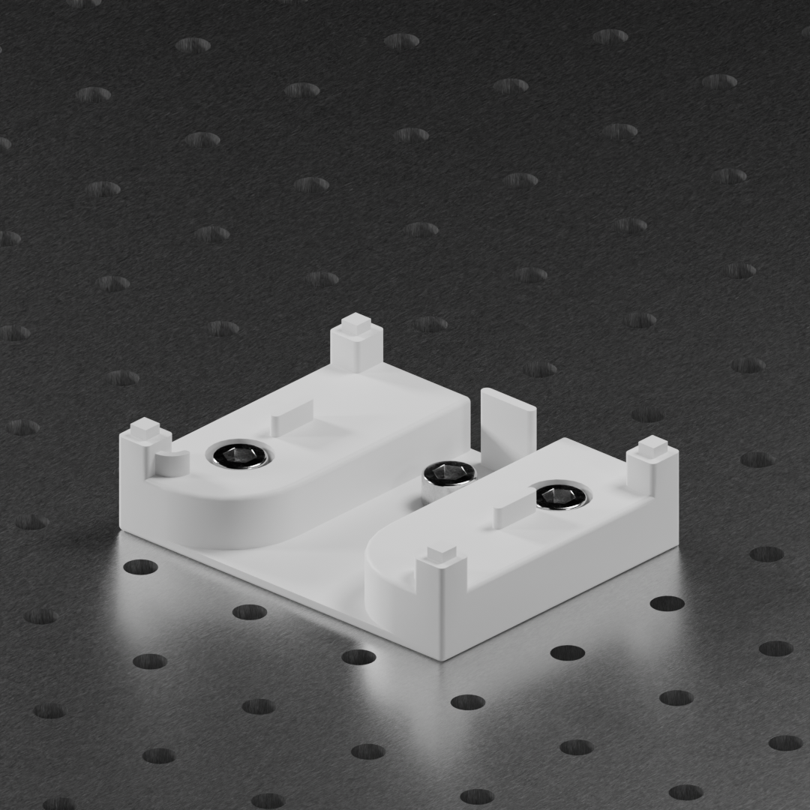
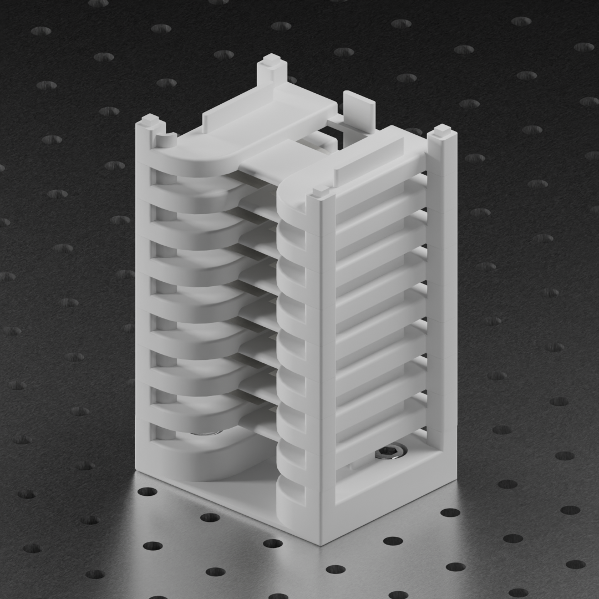
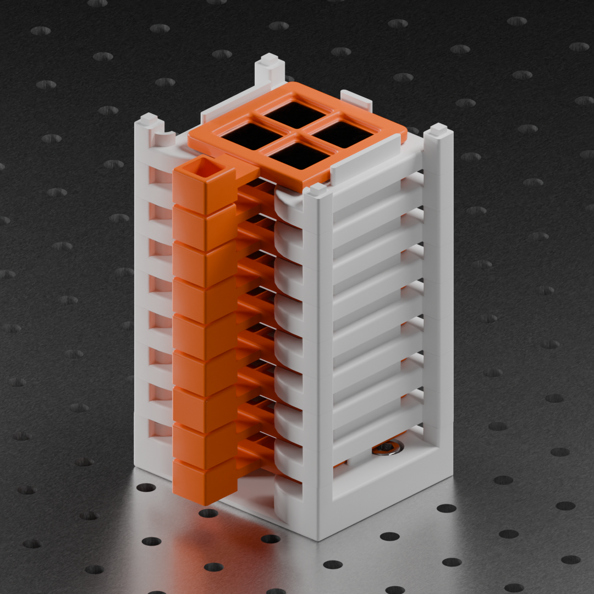
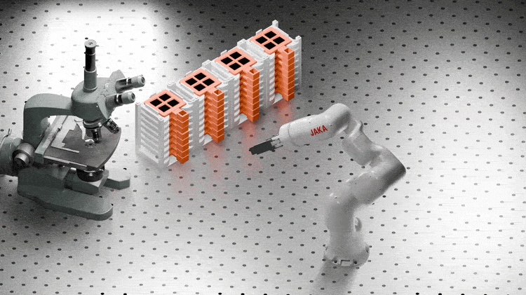
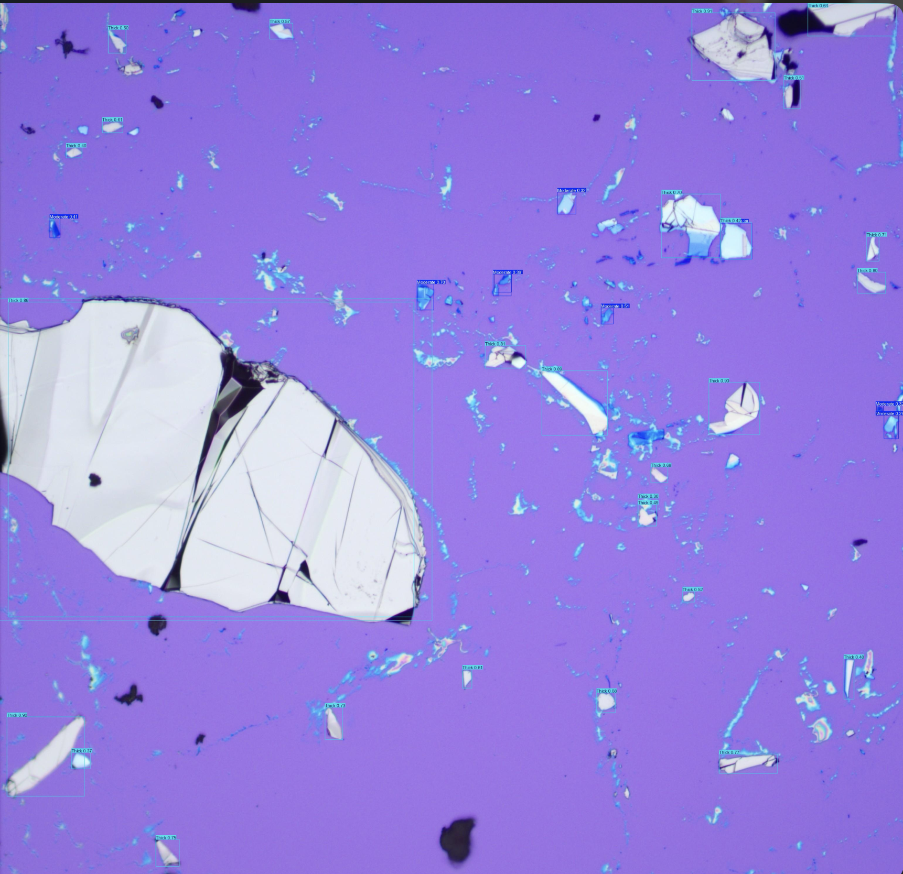
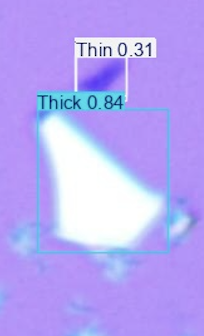

# Robotic Microscopy & Automation for Quantum Materials Research

In the lab's current workflow, an operator loads one chip at a time onto the microscope, manually scans it for graphene flakes, identifies candidate flakes by eye, and records their locations. Repeating these steps for every chip makes sample screening tedious and labor-intensive.

This project aims to automate that workflow from sample storage and microscope loading through scanning, flake identification, and location recording. The planned system combines modular four-chip trays, robotic sample handling, and computer vision to reduce repeated manual intervention.

This project is part of my research in the Lu Lab, led by Dr. Zhengguang Lu, in the Department of physics at Florida State University.

The original concept for this microscopy automation project was proposed by Andre Quintero (FSU). This repository documents my contributions to the system’s design and development.

---

## System Design

### Modular Four-Chip Trays

The previous workflow required manually loading and scanning chips one at a time. I have developed CAD models for trays that each hold **four graphene or hBN chips**, providing a shared carrier for the planned automated microscopy workflow.

The tray holders are modular. Additional holder modules can be added to accommodate more trays, expanding storage capacity as the number of samples grows. Each fully populated tray adds four chip positions.

The design brings together:

- **Four-chip trays** for organizing samples in a shared carrier.
- **Modular tray holders** for expanding sample storage.
- **QR-based tray identification** for tracking samples and their storage locations.
- **Robotic transfer** between sample storage and the microscope.

### Tray and Holder CAD

| Optics-Table Base | Stacked Holders | Full Assembly |
| :---: | :---: | :---: |
|  |  |  |
| Mounting base that attaches the storage system to the optics table. | Empty holder modules showing how additional levels expand storage capacity. | Complete assembly showing how four-chip trays fit into the modular storage system for robotic handling. |

---

## Robotic Pick-and-Place Setup

The planned setup uses an [Anvil OpenYAM](https://shop.anvil.bot/products/openyam) robotic arm for **vision-guided picking and placing** between the tray storage system and the microscope stage.

Working with other members of the Lu Lab, I am designing robotic arm motion-planning and sample-handling algorithms to automate sample transfers between modular trays and the microscope stage.

### Tray Identification and Visual Localization

QR codes will identify individual trays and associate them with their stored samples and locations. Camera images will also be used to estimate the positions of the trays and relevant pickup and placement locations.

The planned vision workflow combines QR-based identification with pixel-level spatial localization. Image coordinates will need to be mapped into the robot's coordinate frame through camera-to-robot calibration to guide the arm's motions. QR identity provides the organizational reference; visual localization provides the spatial information for picking and placing.

The intended workflow is:

```text
Identify Tray from QR Code
          ↓
Locate Pickup and Placement Targets in Camera Images
          ↓
Map Image Locations into Robot Coordinates
          ↓
Plan and Execute Pickup
          ↓
Place at the Microscope for Scanning
          ↓
Return to the Identified Storage Location
```

### Pick-and-Place Demonstration

<p align="center">
  
</p>

---

## Graphene Flake Detection

Alongside the handling system, I have helped manually annotated RGB microscopy images to prepare a training dataset for an Ultralytics YOLO11 vision model.

The annotations identify graphene flakes across different thickness categories and distinguish them from debris. The intended model will use these labels to detect candidate flakes and predict their annotated thickness categories from their appearance in microscope images.

This model is intended to identify suitable thin graphene flakes and estimate their positions within microscope images.
### 10x Model Annotated Image

<p align="center">
    

</p>

### Close-Up Model Predictions

<p align="center">
  

</p>

---


<!-- Media setup: add the referenced files under media/, uncomment each img element, and remove its placeholder caption. -->
